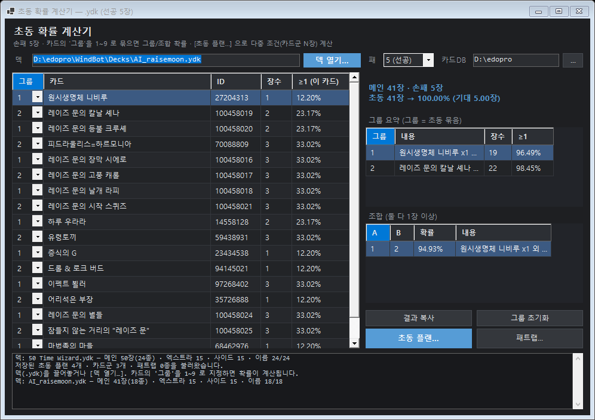
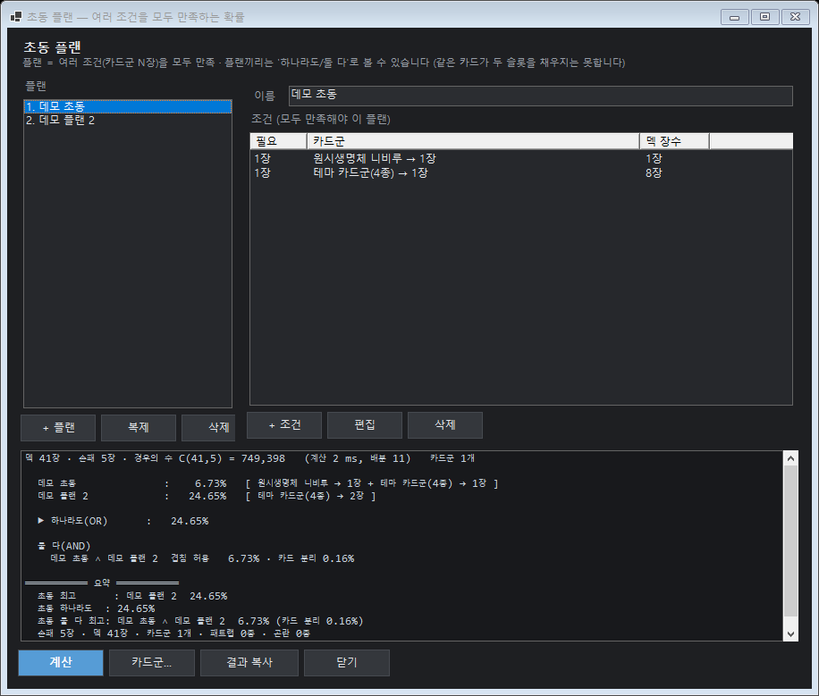
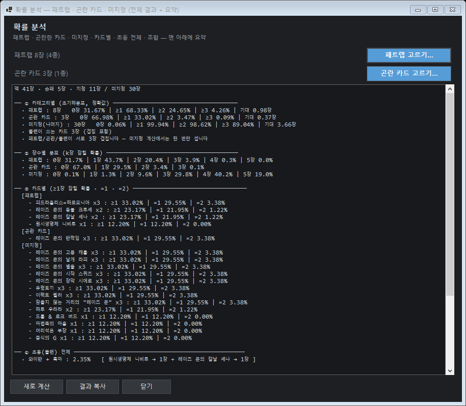

# OpeningCalc — 유희왕 초동 확률 계산기

`.ydk` 덱 파일을 읽어 **선공 5장 / 후공 6장** 기준 확률을 **정확히**(초기하분포, 시뮬레이션 없음) 계산하는 윈도우 앱 + CLI.



## 무엇을 계산하나

| 기능 | 설명 |
|---|---|
| **그룹** | 카드에 그룹 1~9 를 지정하면 그룹별 `≥1 · =1 · ≥2` 와 **두 그룹 동시** 확률 |
| **초동 플랜** | 조건(카드군에서 N장) 여러 개를 **모두** 만족하는 확률 · 플랜끼리 `하나라도` / `둘 다` |
| **카드군** | 여러 카드를 이름으로 묶어 플랜에서 참조 (예: `시간의 흑마술사 테마`) |
| **패트랩** | 패트랩만 따로: `0장 … 손패` 분포 · `≥1 · ≥2` · 기대 장수 |
| **곤란 카드** | 뽑히면 곤란한 카드가 **0장일 확률** |
| **미지정** | 초동·패트랩·곤란에 안 들어간 나머지 카드의 분포 |
| **조합** | `플랜 + 패트랩≥1`, `플랜 + 곤란0`, `둘 다` — 같은 손패에서 함께 성립 |

## 계산 방식

- 단일/카테고리: **초기하분포** 그대로
  `P(k장) = C(c,k)·C(N-c,h-k) / C(N,h)`
- 플랜: 덱 카드를 "어느 슬롯을 채울 수 있나"(비트마스크)로 묶고 손패 배분을 **완전 열거**한 뒤
  **Hall 조건**(부분집합마다 `Σneed ≤ 그 슬롯을 채울 수 있는 장수`)으로 판정.
  같은 카드가 두 슬롯을 동시에 채우지 못한다.
- 모든 값이 **정확값**입니다(오차는 부동소수점 반올림뿐). 자체 검증은 `--selftest`(전수 열거 대조).

## 실행

- 배포본: `OpeningCalc.exe` 하나(자체 포함 단일 파일, .NET 설치 불필요)
- 덱(.ydk)을 **끌어놓기** 또는 `[덱 열기…]` · 카드 이름은 EDOPro `*.cdb` 에서 읽습니다(한국어 우선).

### 화면

1. 메인 — 카드 표(그룹 지정) · 요약 · 그룹/조합 표 · `[초동 플랜…]` `[확률 분석…]`
2. 초동 플랜 — 플랜 목록(좌) · 조건 편집(우) · 결과 + 요약(아래) · `[카드군…]`
   
3. 확률 분석 — ①카테고리 ②분포 ③카드별 ④초동 전체 ⑤조합 ⑥**요약**
   

프리셋(카드군·플랜·패트랩·곤란)은 덱 파일별로 자동 저장됩니다:
`%LOCALAPPDATA%\OpeningCalc\plans\<덱이름>.json`

## CLI

```
OpeningCalc.exe                                    GUI
OpeningCalc.exe --calc <deck.ydk> [--cdb D:\edopro] [--hand 5] [--groups "id,id;id"] [--json]
OpeningCalc.exe --statstext <deck.ydk> [--hand 5]  확률 분석 결과를 텍스트로
OpeningCalc.exe --plancheck <scenario.json>        플랜 확률(JSON in/out, 검증·자동화용)
OpeningCalc.exe --selftest                         수식 자체 검증(전수 열거 대조)
OpeningCalc.exe --uicheck                          창 없이 UI 구성 검사
OpeningCalc.exe --screenshot <png> [deck.ydk]      화면 PNG(레이아웃 확인)
OpeningCalc.exe --planshot <png> [deck.ydk]
OpeningCalc.exe --trapshot <png> [deck.ydk]        확률 분석 창 PNG
```

`scenario.json` 예:

```json
{
  "hand": 5,
  "deck": [{ "id": 4881365, "count": 3 }, { "id": 40235813, "count": 3 }],
  "groups": [{ "name": "흑마 테마", "ids": [40235813, 100458020] }],
  "plans": [
    { "name": "와이반 + 흑마", "slots": [
      { "need": 1, "ids": [4881365] },
      { "need": 1, "groups": ["흑마 테마"] }
    ] }
  ]
}
```

## 빌드

```powershell
# 개발 빌드 (산출물은 Directory.Build.props 로 D:\_proj\build\OpeningCalc\)
dotnet build -c Release

# 단일 파일 배포
dotnet publish -c Release -r win-x64 --self-contained true `
  -p:PublishSingleFile=true -p:IncludeNativeLibrariesForSelfExtract=true -o dist\OpeningCalc
```

- 대상 프레임워크: **.NET 8 (Windows)**
- 카드 이름 조회는 `CardDatabase.cs` 를 링크 컴파일합니다(같은 상위 폴더의 `WindBotAIEditor` 필요).
  없이 빌드하려면 `OpeningCalc.csproj` 의 `<Compile Include="..\WindBotAIEditor\Services\CardDatabase.cs" …>` 줄을 지우고
  `Deck.cs` 의 이름 조회를 `#ID` 로 대체하세요.

## 라이선스 / 데이터

- 카드 이름은 사용자의 EDOPro 설치(`*.cdb`)에서 읽습니다. 카드 데이터는 저장소에 포함하지 않습니다.
